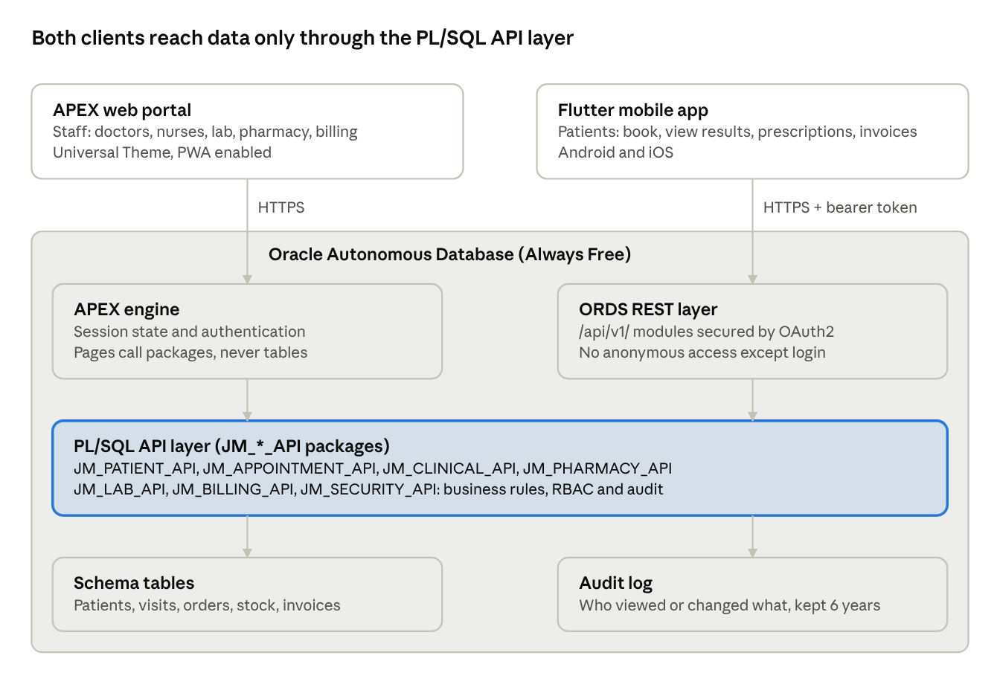

# JanastolMeds — Project Charter & Software Requirements Specification

Oct 27, 2026 · @Adetola

JanastolMeds is a portfolio-grade hospital management system: an Oracle APEX web portal and a Flutter mobile app sharing one Oracle Database through ORDS REST APIs. This document is Part A (Project Charter) and Part B (Software Requirements Specification) of the project documentation set.

## Document control

| Item           | Detail                                                                         |
|----------------|--------------------------------------------------------------------------------|
| Document ID    | JM-DOC-01                                                                      |
| Version        | 0.1 (Draft)                                                                    |
| Owner          | Adetola (Solution Architect / Lead Developer)                                  |
| Next documents | JM-DOC-02 Architecture, JM-DOC-03 Database Design, JM-DOC-04 API Specification |

**Revision history**

| Version | Date        | Author  | Change                           |
|---------|-------------|---------|----------------------------------|
| 0.1     | 27 Oct 2026 | Adetola | Initial draft of charter and SRS |

## Part A — Project Charter

### 1. Purpose

JanastolMeds delivers a working outpatient-focused hospital system in 12 weeks to demonstrate end-to-end professional delivery: requirements, data modelling, secure REST APIs, web and mobile clients, testing and deployment. It targets a small to mid-size Nigerian private hospital as the reference client.

### 2. Objectives

1.  Digitise the outpatient journey: registration, appointment, consultation, prescription, billing.

2.  Give patients a mobile app to book appointments, view prescriptions, lab results and invoices.

3.  Centralise business rules in PL/SQL packages exposed through versioned ORDS REST endpoints.

4.  Meet NDPA 2023 requirements for sensitive health data (consent, access control, audit).

5.  Produce a complete, reusable documentation set and a public GitHub repository.

### 3. Scope

**In scope (MVP, Release 1.0)**

- Patient registration and medical records (EMR summary)

- Doctor schedules and appointment booking

- Outpatient consultation: vitals, diagnosis, notes

- Prescriptions and pharmacy dispensing with stock levels

- Laboratory requests and results

- Billing, payments and invoices (cash, transfer, HMO)

- User, role and audit administration

- Dashboards and standard reports

**Out of scope (future releases)**

- Inpatient admissions, wards and bed management

- Theatre, radiology imaging (PACS) and blood bank

- Live payment gateway integration (stubbed in R1)

- Payroll, HR and general ledger integration

- Telemedicine video consultation

### 4. Stakeholders

| Stakeholder                                     | Role in project                       | Interest                           |
|-------------------------------------------------|---------------------------------------|------------------------------------|
| Adetola                                         | Sponsor, architect, developer, tester | Portfolio quality, learning        |
| Hospital administrator (persona)                | Business owner                        | Efficiency, revenue visibility     |
| Doctors and nurses (persona)                    | Primary web users                     | Fast, accurate clinical records    |
| Pharmacists, lab scientists, cashiers (persona) | Departmental users                    | Clear work queues                  |
| Patients (persona)                              | Mobile app users                      | Convenience, access to own records |
| Data Protection Officer                         | Compliance reviewer                   | NDPA conformance                   |

### 5. Delivery phases

1.  **Initiation and requirements (Weeks 1–2):** charter, SRS, wireframes signed off.

2.  **Design (Weeks 3–4):** architecture, ERD, data dictionary, API specification.

3.  **Backend build (Weeks 5–6):** schema via Liquibase, PL/SQL packages, ORDS modules, OAuth2.

4.  **Web build (Weeks 7–8):** APEX portal, all staff modules, reports.

5.  **Mobile build (Weeks 9–10):** Flutter patient app against ORDS.

6.  **Testing (Week 11):** unit (utPLSQL), API (Postman), UAT scripts.

7.  **Deployment and handover (Week 12):** Autonomous DB deployment, user manual, demo video, release notes.

### 6. Key risks

| Risk                               | Impact                | Mitigation                                                  |
|------------------------------------|-----------------------|-------------------------------------------------------------|
| Scope creep into inpatient modules | Missed 12-week target | Strict MVP list; new items go to backlog                    |
| Real patient data used in testing  | NDPA breach           | Synthetic seed data only                                    |
| ORDS security misconfigured        | Data exposure         | OAuth2 on every module; no anonymous endpoints except login |
| Always Free tier limits            | Performance in demo   | Keep data volume small; monitor usage                       |
| Solo developer bandwidth           | Delays                | Weekly milestone review; time-boxed sprints                 |

### 7. Assumptions and constraints

- Single-hospital, single-branch deployment; multi-branch is a future release.

- Hosted on Oracle Autonomous Database (Always Free) with APEX 24.2 and ORDS.

- Currency is NGN; dates follow DD-MON-YYYY in the UI.

- English is the only UI language in Release 1.0.

## Part B — Software Requirements Specification

### 8. Introduction

This SRS defines what JanastolMeds Release 1.0 must do and how well it must do it; it is the baseline for design, testing and UAT sign-off. Requirements use the keyword **shall** for mandatory items and **should** for desirable ones.

**Definitions**

| Term | Meaning                                                                |
|------|------------------------------------------------------------------------|
| EMR  | Electronic Medical Record — the patient's clinical history             |
| HMO  | Health Maintenance Organisation — third-party payer under NHIA schemes |
| MRN  | Medical Record Number — unique patient ID, format JM-YYYY-NNNNNN       |
| ORDS | Oracle REST Data Services — exposes PL/SQL as REST endpoints           |
| NDPA | Nigeria Data Protection Act 2023                                       |
| RBAC | Role-based access control                                              |

### 9. Product perspective

JanastolMeds is a new, self-contained system. Staff use the APEX web portal on desktops and tablets; patients use the Flutter mobile app on Android and iOS. Both clients go through the same PL/SQL API layer, so a business rule (for example, no double-booking) is enforced once.

### 10. User roles

| Role                      | Client               | Main capabilities                                               |
|---------------------------|----------------------|-----------------------------------------------------------------|
| System Administrator      | Web                  | Users, roles, departments, lookups, audit review                |
| Front Desk / Records      | Web                  | Register patients, book and check in appointments               |
| Doctor                    | Web, mobile (should) | Queue, consultation notes, diagnosis, prescriptions, lab orders |
| Nurse                     | Web                  | Vitals, triage, patient queue                                   |
| Pharmacist                | Web                  | Dispense prescriptions, manage drug stock                       |
| Lab Scientist             | Web                  | Receive samples, enter and verify results                       |
| Cashier / Billing Officer | Web                  | Invoices, payments, HMO claims                                  |
| Hospital Manager          | Web                  | Dashboards and reports (read-only)                              |
| Patient                   | Mobile               | Profile, appointments, prescriptions, results, invoices         |

### 11. Operating environment

| Layer          | Technology                                                    |
|----------------|---------------------------------------------------------------|
| Database       | Oracle Autonomous Database 19c/23ai (Always Free)             |
| Business logic | PL/SQL packages (JM\_\*\_API)                                 |
| REST layer     | ORDS with OAuth2 (client credentials and password/token flow) |
| Web client     | Oracle APEX 24.2, Universal Theme, PWA enabled                |
| Mobile client  | Flutter 3.x, Dart, Android 8+ and iOS 15+                     |
| Source control | GitHub; SQLcl apex export -split and Liquibase changelogs     |
| Testing        | utPLSQL, Postman/Newman, Flutter test                         |

### 12. Functional requirements

Each requirement has a unique ID (FR-module-nn) used for design, test cases and traceability. Priority follows MoSCoW: M = Must, S = Should, C = Could.

**12.1 Patient Management (PAT)**

| ID        | Requirement                                                                                                              | Priority |
|-----------|--------------------------------------------------------------------------------------------------------------------------|----------|
| FR-PAT-01 | The system shall register a patient with demographics, next of kin, HMO details and photo, and generate a unique MRN.    | M        |
| FR-PAT-02 | The system shall detect likely duplicates (same name, date of birth and phone) before saving.                            | M        |
| FR-PAT-03 | The system shall record patient consent for data processing, with date and version of the privacy notice.                | M        |
| FR-PAT-04 | Patients shall self-register on the mobile app; records stay "Pending verification" until front desk confirms identity.  | S        |
| FR-PAT-05 | Authorised clinicians shall view a patient summary: allergies, chronic conditions, last 10 visits, active prescriptions. | M        |

**12.2 Appointments (APT)**

| ID        | Requirement                                                                                           | Priority |
|-----------|-------------------------------------------------------------------------------------------------------|----------|
| FR-APT-01 | Admins shall define doctor schedules (days, slot length, max patients per session).                   | M        |
| FR-APT-02 | Front desk and patients shall book only available slots; the system shall block double-booking.       | M        |
| FR-APT-03 | The system shall support statuses Booked, Checked-in, In consultation, Completed, Cancelled, No-show. | M        |
| FR-APT-04 | Patients shall cancel or reschedule up to 2 hours before the slot from the mobile app.                | S        |
| FR-APT-05 | The system should send a reminder notification 24 hours before the appointment.                       | C        |

**12.3 Clinical / Consultation (CLN)**

| ID        | Requirement                                                                                                     | Priority |
|-----------|-----------------------------------------------------------------------------------------------------------------|----------|
| FR-CLN-01 | Nurses shall record vitals: temperature, BP, pulse, respiration, weight, height (BMI auto-calculated).          | M        |
| FR-CLN-02 | Doctors shall see a live queue of checked-in patients ordered by check-in time and triage priority.             | M        |
| FR-CLN-03 | Doctors shall record complaints, examination notes and diagnoses coded with ICD-10.                             | M        |
| FR-CLN-04 | Consultation records shall lock 24 hours after completion; later changes are addenda with author and timestamp. | M        |

**12.4 Pharmacy (PHM)**

| ID        | Requirement                                                                                                       | Priority |
|-----------|-------------------------------------------------------------------------------------------------------------------|----------|
| FR-PHM-01 | Doctors shall prescribe from the drug formulary with dose, frequency, duration and quantity.                      | M        |
| FR-PHM-02 | The system shall warn on recorded drug allergies before a prescription is saved.                                  | M        |
| FR-PHM-03 | Pharmacists shall dispense full or partial quantities; stock reduces on dispense.                                 | M        |
| FR-PHM-04 | The system shall track batch numbers and expiry dates, and flag items below reorder level or expiring in 90 days. | S        |

**12.5 Laboratory (LAB)**

| ID        | Requirement                                                                                             | Priority |
|-----------|---------------------------------------------------------------------------------------------------------|----------|
| FR-LAB-01 | Doctors shall order tests from the lab test catalogue.                                                  | M        |
| FR-LAB-02 | Lab scientists shall record sample collection, results with reference ranges, and flag abnormal values. | M        |
| FR-LAB-03 | Results shall need verification by a second lab user before release to doctor and patient.              | M        |
| FR-LAB-04 | Patients shall view released results on the mobile app and download a PDF report.                       | S        |

**12.6 Billing (BIL)**

| ID        | Requirement                                                                                                        | Priority |
|-----------|--------------------------------------------------------------------------------------------------------------------|----------|
| FR-BIL-01 | The system shall add charges automatically from consultation, lab orders and dispensed drugs using the price list. | M        |
| FR-BIL-02 | Cashiers shall record payments by cash, transfer, POS or HMO, including part payments, and issue receipts.         | M        |
| FR-BIL-03 | HMO-covered items shall be split between HMO and patient portions per the HMO plan.                                | S        |
| FR-BIL-04 | Patients shall view invoices and payment history on the mobile app.                                                | S        |
| FR-BIL-05 | The system should expose a payment-gateway interface stub for future integration.                                  | C        |

**12.7 Administration and Reporting (ADM)**

| ID        | Requirement                                                                                           | Priority |
|-----------|-------------------------------------------------------------------------------------------------------|----------|
| FR-ADM-01 | Admins shall manage users, roles, departments and lookup values.                                      | M        |
| FR-ADM-02 | Every create, update, delete and view of clinical data shall be written to an audit log.              | M        |
| FR-ADM-03 | Managers shall see a dashboard: daily visits, revenue, top diagnoses, pending lab results, low stock. | M        |
| FR-ADM-04 | Standard reports shall export to PDF and Excel.                                                       | S        |

**Sample user stories**

- As a **patient**, I want to book an appointment from my phone so that I don't queue at the front desk.

- As a **doctor**, I want to see allergies before prescribing so that I avoid adverse reactions.

- As a **cashier**, I want charges to appear automatically so that no service goes unbilled.

- As a **DPO**, I want every access to patient records logged so that I can investigate breaches.

### 13. Non-functional requirements

Health data is sensitive personal data under the NDPA 2023, so security and privacy requirements are all Must-have.

| ID         | Category            | Requirement                                                                                                      |
|------------|---------------------|------------------------------------------------------------------------------------------------------------------|
| NFR-SEC-01 | Authentication      | Staff sign in through APEX authentication; mobile users through ORDS OAuth2 tokens that expire after 60 minutes. |
| NFR-SEC-02 | Authorisation       | RBAC enforced in PL/SQL, not only in the UI; a patient can only ever retrieve their own records.                 |
| NFR-SEC-03 | Passwords           | Stored as salted hashes; minimum 10 characters; lockout after 5 failed attempts.                                 |
| NFR-SEC-04 | Transport           | All traffic over HTTPS (TLS 1.2+); no anonymous REST endpoints except login and registration.                    |
| NFR-SEC-05 | Injection           | All SQL uses bind variables; no dynamic SQL built from user input.                                               |
| NFR-PRV-01 | Consent             | Consent captured and versioned at registration (FR-PAT-03).                                                      |
| NFR-PRV-02 | Minimisation        | Each role sees only the fields it needs; contact details masked in lists.                                        |
| NFR-PRV-03 | Audit               | Access to clinical records logged with user, time, record and action; logs kept 6 years and tamper-evident.      |
| NFR-PRV-04 | Data subject rights | Admin can export a patient's full record (access request) and anonymise records on lawful erasure request.       |
| NFR-PRV-05 | Test data           | Only synthetic data in dev, test and demo environments.                                                          |
| NFR-PRF-01 | Performance         | 95% of pages and API calls respond in under 2 seconds with 50 concurrent users.                                  |
| NFR-AVL-01 | Availability        | 99% during working hours (07:00–20:00 WAT); automatic daily backups via Autonomous DB.                           |
| NFR-USB-01 | Usability           | Responsive web UI usable on 10-inch tablets; core mobile tasks done in 3 taps or fewer.                          |
| NFR-USB-02 | Accessibility       | Should meet WCAG 2.1 AA for contrast and keyboard navigation.                                                    |
| NFR-MNT-01 | Maintainability     | Business logic only in JM\_\*\_API packages; APEX pages call packages, not tables directly.                      |
| NFR-MNT-02 | Versioning          | APIs versioned as /api/v1/; breaking changes need a new version.                                                 |

### 14. System architecture and interfaces

All business rules live in one PL/SQL API layer; APEX calls it directly inside the database and the mobile app reaches it only through ORDS. Full detail goes in JM-DOC-02 Architecture.

*Figure: JanastolMeds architecture: 2 clients, 1 API layer*

A rule such as "no double-booking" or "patients see only their own records" is coded once in the packages, so web and mobile can never disagree.

**Core REST endpoints (v1)**

| Method | Endpoint                         | Purpose                                  | Caller |
|--------|----------------------------------|------------------------------------------|--------|
| POST   | /api/v1/auth/token               | Issue OAuth2 access token                | Mobile |
| POST   | /api/v1/patients                 | Self-registration (pending verification) | Mobile |
| GET    | /api/v1/patients/me              | Own profile and summary                  | Mobile |
| GET    | /api/v1/doctors/{id}/slots?date= | Available appointment slots              | Mobile |
| POST   | /api/v1/appointments             | Book an appointment                      | Mobile |
| PATCH  | /api/v1/appointments/{id}        | Cancel or reschedule                     | Mobile |
| GET    | /api/v1/prescriptions            | Own prescriptions                        | Mobile |
| GET    | /api/v1/lab-results              | Own released lab results                 | Mobile |
| GET    | /api/v1/invoices                 | Own invoices and payments                | Mobile |

All responses are JSON with standard HTTP status codes; errors return {code, message}. The full contract (OpenAPI) goes in JM-DOC-04.

### 15. Acceptance criteria

Release 1.0 is accepted when all of the following hold:

- [ ] All Must-have functional requirements pass their UAT test cases.

- [ ] All NFR-SEC and NFR-PRV requirements pass security tests, including a check that a patient token cannot read another patient's data.

- [ ] utPLSQL coverage of JM\_\*\_API packages is at least 70%.

- [ ] The Postman collection runs green for every /api/v1/ endpoint.

- [ ] The end-to-end scenario works: patient books on mobile → checked in → vitals → consultation → lab order and result → prescription dispensed → invoice paid → patient sees result and receipt on mobile.

- [ ] Documentation set JM-DOC-01 to JM-DOC-09 is complete in the repository.

### 16. Traceability

Each FR and NFR ID will be carried into the design documents, test cases (TC-module-nn) and Git commit messages. The traceability matrix lives in JM-DOC-07 Test Plan.

### 17. Sign-off

| Role                      | Name    | Signature | Date |
|---------------------------|---------|-----------|------|
| Project Sponsor           | Adetola |           |      |
| Business Owner (reviewer) |         |           |      |
| Data Protection Officer   |         |           |      |
