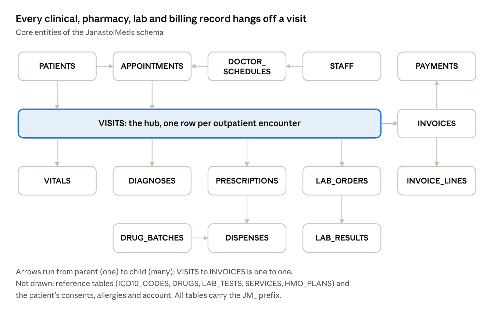

# JanastolMeds — Database Design (JM-DOC-03)

Oct 27, 2026 · @Adetola

The JanastolMeds Release 1.0 schema has 29 tables in 7 modules, all in one schema (JMEDS), with the patient visit as the hub that links clinical, pharmacy, lab and billing data. This document implements the requirements in JM-DOC-01 and is the source for the Liquibase changelogs in database/changelogs/.

## Document control

| Item        | Detail                          |
|-------------|---------------------------------|
| Document ID | JM-DOC-03                       |
| Version     | 0.2 (Draft)                     |
| Owner       | Adetola                         |
| Depends on  | JM-DOC-01 Project Charter & SRS |

## 1. Design conventions

| Area             | Convention                                                                             | Example                      |
|------------------|----------------------------------------------------------------------------------------|------------------------------|
| Schema           | One application schema; APEX and ORDS parse as it                                      | JMEDS                        |
| Table names      | Prefix JM\_, plural, upper case                                                        | JM_PATIENTS                  |
| Primary keys     | Surrogate \<ENTITY\>\_ID NUMBER as identity column                                     | PATIENT_ID                   |
| Foreign keys     | Same name as the parent's primary key                                                  | JM_VISITS.PATIENT_ID         |
| Business keys    | Separate unique column, never the PK                                                   | MRN, INVOICE_NO              |
| Constraint names | \<TABLE\>\_PK, \<TABLE\>\_\<COL\>\_FK, \<TABLE\>\_\<COL\>\_UK, \<TABLE\>\_\<RULE\>\_CK | JM_APPOINTMENTS_SLOT_UK      |
| Indexes          | Every foreign key indexed: \<TABLE\>\_\<COL\>\_IX                                      | JM_VISITS_PATIENT_IX         |
| Strings          | VARCHAR2(n CHAR) so names with accents fit                                             | FIRST_NAME VARCHAR2(60 CHAR) |
| Money            | NUMBER(12,2) in NGN                                                                    | AMOUNT                       |
| Dates            | DATE for calendar dates; TIMESTAMP WITH LOCAL TIME ZONE for events                     | CHECKED_IN_AT                |
| Flags            | VARCHAR2(1) with check IN ('Y','N')                                                    | ACTIVE_FLAG                  |
| Status codes     | Short codes checked against a list; labels come from JM_LOOKUPS                        | STATUS = 'BOOKED'            |
| Deletes          | Soft delete for master data (ACTIVE_FLAG = 'N'); clinical records are never deleted    | —                            |

**Standard audit columns** on every table, set by a shared trigger template:

| Column      | Type                           | Rule                                                                   |
|-------------|--------------------------------|------------------------------------------------------------------------|
| CREATED_BY  | VARCHAR2(100 CHAR)             | APEX user, ORDS client or USER                                         |
| CREATED_ON  | TIMESTAMP WITH LOCAL TIME ZONE | Default SYSTIMESTAMP                                                   |
| UPDATED_BY  | VARCHAR2(100 CHAR)             | Set on every update                                                    |
| UPDATED_ON  | TIMESTAMP WITH LOCAL TIME ZONE | Set on every update                                                    |
| ROW_VERSION | NUMBER                         | Incremented on update, used for optimistic locking by APEX and the API |

These five columns are not repeated in the data dictionary below.

## 2. Entity catalogue

Every table traces to at least one SRS requirement; a table with no requirement behind it is not built in Release 1.0.

| Module       | Table                | Purpose                                                                | Serves                |
|--------------|----------------------|------------------------------------------------------------------------|-----------------------|
| Admin        | JM_DEPARTMENTS       | Clinical and support departments (OPD, Lab, Pharmacy, Billing)         | FR-ADM-01             |
| Admin        | JM_STAFF             | Every staff member; doctors are staff with a specialty                 | FR-ADM-01             |
| Admin        | JM_ROLES             | Application roles (DOCTOR, NURSE, PHARMACIST…)                         | FR-ADM-01, NFR-SEC-02 |
| Admin        | JM_STAFF_ROLES       | Which staff hold which roles (many-to-many)                            | NFR-SEC-02            |
| Admin        | JM_LOOKUPS           | Generic code lists: gender, blood group, payment method, status labels | FR-ADM-01             |
| Admin        | JM_AUDIT_LOG         | Append-only record of every view and change of clinical data           | FR-ADM-02, NFR-PRV-03 |
| Patient      | JM_PATIENTS          | Patient master record with MRN and demographics                        | FR-PAT-01, 02, 04     |
| Patient      | JM_PATIENT_CONSENTS  | Consent given per privacy-notice version                               | FR-PAT-03, NFR-PRV-01 |
| Patient      | JM_PATIENT_ALLERGIES | Known allergies, optionally linked to a drug                           | FR-PAT-05, FR-PHM-02  |
| Patient      | JM_HMO_PLANS         | HMOs and their plans with coverage percentage                          | FR-BIL-03             |
| Patient      | JM_PATIENT_ACCOUNTS  | Mobile login for patients, separate from staff                         | NFR-SEC-01, 03        |
| Appointments | JM_DOCTOR_SCHEDULES  | Weekly sessions per doctor: day, times, slot length, capacity          | FR-APT-01             |
| Appointments | JM_APPOINTMENTS      | A booked slot and its status                                           | FR-APT-02, 03, 04     |
| Clinical     | JM_VISITS            | One outpatient encounter: complaint, notes, triage, lock status        | FR-CLN-02, 03, 04     |
| Clinical     | JM_VITALS            | Vital signs taken during a visit                                       | FR-CLN-01             |
| Clinical     | JM_ICD10_CODES       | ICD-10 reference list                                                  | FR-CLN-03             |
| Clinical     | JM_VISIT_DIAGNOSES   | Diagnoses recorded at a visit                                          | FR-CLN-03, FR-ADM-03  |
| Clinical     | JM_VISIT_ADDENDA     | Notes added after a visit is locked                                    | FR-CLN-04             |
| Pharmacy     | JM_DRUGS             | Drug formulary with price and reorder level                            | FR-PHM-01, 04         |
| Pharmacy     | JM_DRUG_BATCHES      | Stock on hand per batch with expiry date                               | FR-PHM-03, 04         |
| Pharmacy     | JM_PRESCRIPTIONS     | One prescribed drug line on a visit                                    | FR-PHM-01, 02         |
| Pharmacy     | JM_DISPENSES         | Quantity issued from a batch against a prescription                    | FR-PHM-03             |
| Lab          | JM_LAB_TESTS         | Lab test catalogue with reference ranges and price                     | FR-LAB-01             |
| Lab          | JM_LAB_ORDERS        | A test ordered at a visit and its workflow status                      | FR-LAB-01, 02         |
| Lab          | JM_LAB_RESULTS       | Result value, abnormal flag, entry and verification                    | FR-LAB-02, 03, 04     |
| Billing      | JM_SERVICES          | Price list for consultations and other chargeable services             | FR-BIL-01             |
| Billing      | JM_INVOICES          | One invoice per visit with HMO and patient portions                    | FR-BIL-01, 03, 04     |
| Billing      | JM_INVOICE_LINES     | Individual charges, each traced to its source record                   | FR-BIL-01             |
| Billing      | JM_PAYMENTS          | Payments and part-payments against an invoice                          | FR-BIL-02             |

## 3. Entity relationship diagram

The visit is the centre of the model: an appointment becomes a visit, and vitals, diagnoses, prescriptions, lab orders and the invoice all belong to that visit.

*Figure: JanastolMeds ERD: 15 core entities*

Because billing hangs off the visit, every chargeable event (consultation, lab test, dispensed drug) can be traced to the encounter and patient that caused it.

## 4. Data dictionary

Null column: **N** = NOT NULL, **Y** = nullable. Audit columns from section 1 are on every table and omitted here.

### 4.1 Admin

**JM_DEPARTMENTS**

| Column        | Type               | Null | Notes                  |
|---------------|--------------------|------|------------------------|
| DEPARTMENT_ID | NUMBER             | N    | PK, identity           |
| DEPT_CODE     | VARCHAR2(10 CHAR)  | N    | UK, e.g. OPD, LAB, PHM |
| DEPT_NAME     | VARCHAR2(100 CHAR) | N    |                        |
| ACTIVE_FLAG   | VARCHAR2(1)        | N    | Y/N, default Y         |

**JM_STAFF**

| Column        | Type               | Null | Notes                               |
|---------------|--------------------|------|-------------------------------------|
| STAFF_ID      | NUMBER             | N    | PK, identity                        |
| STAFF_NO      | VARCHAR2(20 CHAR)  | N    | UK, employee number                 |
| USERNAME      | VARCHAR2(100 CHAR) | N    | UK, matches APEX login (upper case) |
| FIRST_NAME    | VARCHAR2(60 CHAR)  | N    |                                     |
| LAST_NAME     | VARCHAR2(60 CHAR)  | N    |                                     |
| TITLE         | VARCHAR2(20 CHAR)  | Y    | Dr, Mrs, Pharm…                     |
| DEPARTMENT_ID | NUMBER             | N    | FK → JM_DEPARTMENTS                 |
| SPECIALTY     | VARCHAR2(100 CHAR) | Y    | Doctors only                        |
| LICENCE_NO    | VARCHAR2(30 CHAR)  | Y    | MDCN / PCN / MLSCN number           |
| EMAIL         | VARCHAR2(150 CHAR) | Y    |                                     |
| PHONE         | VARCHAR2(20 CHAR)  | Y    |                                     |
| ACTIVE_FLAG   | VARCHAR2(1)        | N    | Y/N                                 |

**JM_ROLES**

| Column    | Type               | Null | Notes                                                                     |
|-----------|--------------------|------|---------------------------------------------------------------------------|
| ROLE_ID   | NUMBER             | N    | PK, identity                                                              |
| ROLE_CODE | VARCHAR2(30 CHAR)  | N    | UK: ADMIN, FRONTDESK, DOCTOR, NURSE, PHARMACIST, LABSCI, CASHIER, MANAGER |
| ROLE_NAME | VARCHAR2(100 CHAR) | N    |                                                                           |

**JM_STAFF_ROLES**

| Column        | Type   | Null | Notes                                 |
|---------------|--------|------|---------------------------------------|
| STAFF_ROLE_ID | NUMBER | N    | PK, identity                          |
| STAFF_ID      | NUMBER | N    | FK → JM_STAFF                         |
| ROLE_ID       | NUMBER | N    | FK → JM_ROLES; UK (STAFF_ID, ROLE_ID) |

**JM_LOOKUPS**

| Column      | Type               | Null | Notes                                            |
|-------------|--------------------|------|--------------------------------------------------|
| LOOKUP_ID   | NUMBER             | N    | PK, identity                                     |
| LOOKUP_TYPE | VARCHAR2(30 CHAR)  | N    | e.g. GENDER, BLOOD_GROUP, PAY_METHOD, APT_STATUS |
| LOOKUP_CODE | VARCHAR2(30 CHAR)  | N    | UK (LOOKUP_TYPE, LOOKUP_CODE)                    |
| MEANING     | VARCHAR2(100 CHAR) | N    | Display label                                    |
| DISPLAY_SEQ | NUMBER(4)          | Y    | Sort order in lists                              |
| ACTIVE_FLAG | VARCHAR2(1)        | N    | Y/N                                              |

**JM_AUDIT_LOG** (no audit columns; insert-only, no UPDATE or DELETE grants)

| Column     | Type                           | Null | Notes                                                                 |
|------------|--------------------------------|------|-----------------------------------------------------------------------|
| AUDIT_ID   | NUMBER                         | N    | PK, identity                                                          |
| EVENT_AT   | TIMESTAMP WITH LOCAL TIME ZONE | N    | Default SYSTIMESTAMP                                                  |
| ACTOR      | VARCHAR2(100 CHAR)             | N    | Staff username or patient account                                     |
| ACTOR_TYPE | VARCHAR2(10 CHAR)              | N    | STAFF / PATIENT / SYSTEM                                              |
| ACTION     | VARCHAR2(10 CHAR)              | N    | VIEW / INSERT / UPDATE / DELETE / EXPORT                              |
| TABLE_NAME | VARCHAR2(30 CHAR)              | N    |                                                                       |
| RECORD_ID  | NUMBER                         | N    | PK of the affected row                                                |
| PATIENT_ID | NUMBER                         | Y    | For per-patient access reports (no FK, so logs survive anonymisation) |
| CLIENT     | VARCHAR2(10 CHAR)              | N    | APEX / ORDS / JOB                                                           |
| IP_ADDRESS | VARCHAR2(45 CHAR)              | Y    | IPv4 or IPv6                                                          |
| DETAIL     | CLOB                           | Y    | JSON of changed columns (old and new values)                          |
| PREV_HASH  | VARCHAR2(64 CHAR)              | Y    | Hash of previous row: tamper evidence                                 |
| ROW_HASH   | VARCHAR2(64 CHAR)              | N    | SHA-256 of this row + PREV_HASH                                       |

### 4.2 Patient

**JM_PATIENTS**

| Column           | Type               | Null | Notes                                         |
|------------------|--------------------|------|-----------------------------------------------|
| PATIENT_ID       | NUMBER             | N    | PK, identity                                  |
| MRN              | VARCHAR2(20 CHAR)  | N    | UK, format JM-YYYY-NNNNNN, from a sequence    |
| FIRST_NAME       | VARCHAR2(60 CHAR)  | N    |                                               |
| MIDDLE_NAME      | VARCHAR2(60 CHAR)  | Y    |                                               |
| LAST_NAME        | VARCHAR2(60 CHAR)  | N    |                                               |
| DATE_OF_BIRTH    | DATE               | N    |                                               |
| GENDER           | VARCHAR2(10 CHAR)  | N    | Lookup GENDER                                 |
| BLOOD_GROUP      | VARCHAR2(5 CHAR)   | Y    | Lookup BLOOD_GROUP                            |
| GENOTYPE         | VARCHAR2(5 CHAR)   | Y    | AA, AS, SS, AC…                               |
| PHONE            | VARCHAR2(20 CHAR)  | N    | Used in duplicate check                       |
| EMAIL            | VARCHAR2(150 CHAR) | Y    |                                               |
| ADDRESS          | VARCHAR2(300 CHAR) | Y    |                                               |
| STATE_OF_ORIGIN  | VARCHAR2(50 CHAR)  | Y    |                                               |
| NOK_NAME         | VARCHAR2(120 CHAR) | Y    | Next of kin                                   |
| NOK_PHONE        | VARCHAR2(20 CHAR)  | Y    |                                               |
| NOK_RELATIONSHIP | VARCHAR2(30 CHAR)  | Y    |                                               |
| HMO_PLAN_ID      | NUMBER             | Y    | FK → JM_HMO_PLANS; null = self-pay            |
| HMO_MEMBER_NO    | VARCHAR2(30 CHAR)  | Y    | Required when HMO_PLAN_ID set                 |
| PHOTO            | BLOB               | Y    |                                               |
| PHOTO_MIME       | VARCHAR2(50 CHAR)  | Y    |                                               |
| STATUS           | VARCHAR2(10 CHAR)  | N    | PENDING / ACTIVE / ANONYMISED; default ACTIVE |
| REG_CHANNEL      | VARCHAR2(10 CHAR)  | N    | DESK / MOBILE                                 |

**JM_PATIENT_CONSENTS**

| Column         | Type                           | Null | Notes                            |
|----------------|--------------------------------|------|----------------------------------|
| CONSENT_ID     | NUMBER                         | N    | PK, identity                     |
| PATIENT_ID     | NUMBER                         | N    | FK → JM_PATIENTS                 |
| NOTICE_VERSION | VARCHAR2(10 CHAR)              | N    | Privacy notice version, e.g. 1.0 |
| CONSENT_TYPE   | VARCHAR2(20 CHAR)              | N    | PROCESSING / SMS_REMINDERS       |
| GRANTED_FLAG   | VARCHAR2(1)                    | N    | Y/N                              |
| GRANTED_AT     | TIMESTAMP WITH LOCAL TIME ZONE | N    |                                  |
| WITHDRAWN_AT   | TIMESTAMP WITH LOCAL TIME ZONE | Y    |                                  |
| CAPTURED_VIA   | VARCHAR2(10 CHAR)              | N    | DESK / MOBILE                    |

**JM_PATIENT_ALLERGIES**

| Column      | Type               | Null | Notes                                          |
|-------------|--------------------|------|------------------------------------------------|
| ALLERGY_ID  | NUMBER             | N    | PK, identity                                   |
| PATIENT_ID  | NUMBER             | N    | FK → JM_PATIENTS                               |
| ALLERGEN    | VARCHAR2(100 CHAR) | N    | Free text, e.g. Penicillin                     |
| DRUG_ID     | NUMBER             | Y    | FK → JM_DRUGS, enables the prescribing warning |
| SEVERITY    | VARCHAR2(10 CHAR)  | N    | MILD / MODERATE / SEVERE                       |
| REACTION    | VARCHAR2(200 CHAR) | Y    |                                                |
| ACTIVE_FLAG | VARCHAR2(1)        | N    | Y/N                                            |

**JM_HMO_PLANS**

| Column       | Type               | Null | Notes                    |
|--------------|--------------------|------|--------------------------|
| HMO_PLAN_ID  | NUMBER             | N    | PK, identity             |
| HMO_NAME     | VARCHAR2(100 CHAR) | N    |                          |
| PLAN_NAME    | VARCHAR2(100 CHAR) | N    | UK (HMO_NAME, PLAN_NAME) |
| COVERAGE_PCT | NUMBER(5,2)        | N    | 0–100, share paid by HMO |
| CLAIMS_EMAIL | VARCHAR2(150 CHAR) | Y    |                          |
| ACTIVE_FLAG  | VARCHAR2(1)        | N    | Y/N                      |

**JM_PATIENT_ACCOUNTS**

| Column          | Type                           | Null | Notes                                          |
|-----------------|--------------------------------|------|------------------------------------------------|
| ACCOUNT_ID      | NUMBER                         | N    | PK, identity                                   |
| PATIENT_ID      | NUMBER                         | N    | FK → JM_PATIENTS; UK (one account per patient) |
| LOGIN_ID        | VARCHAR2(150 CHAR)             | N    | UK, email or phone                             |
| PASSWORD_HASH   | VARCHAR2(200 CHAR)             | N    | Salted hash (never plain text)                 |
| PASSWORD_SALT   | VARCHAR2(64 CHAR)              | N    |                                                |
| FAILED_ATTEMPTS | NUMBER(2)                      | N    | Default 0; lock at 5                           |
| LOCKED_FLAG     | VARCHAR2(1)                    | N    | Y/N                                            |
| LAST_LOGIN_AT   | TIMESTAMP WITH LOCAL TIME ZONE | Y    |                                                |

### 4.3 Appointments

**JM_DOCTOR_SCHEDULES**

| Column       | Type             | Null | Notes                                 |
|--------------|------------------|------|---------------------------------------|
| SCHEDULE_ID  | NUMBER           | N    | PK, identity                          |
| STAFF_ID     | NUMBER           | N    | FK → JM_STAFF (must hold DOCTOR role) |
| DAY_OF_WEEK  | NUMBER(1)        | N    | 1 = Monday … 7 = Sunday               |
| START_TIME   | VARCHAR2(5 CHAR) | N    | HH24:MI, e.g. 09:00                   |
| END_TIME     | VARCHAR2(5 CHAR) | N    | Later than START_TIME                 |
| SLOT_MINUTES | NUMBER(3)        | N    | e.g. 15, 20, 30                       |
| MAX_PATIENTS | NUMBER(3)        | N    | Cap per session                       |
| VALID_FROM   | DATE             | N    |                                       |
| VALID_TO     | DATE             | Y    | Null = open-ended                     |

**JM_APPOINTMENTS**

| Column         | Type                           | Null | Notes                                                              |
|----------------|--------------------------------|------|--------------------------------------------------------------------|
| APPOINTMENT_ID | NUMBER                         | N    | PK, identity                                                       |
| APPOINTMENT_NO | VARCHAR2(20 CHAR)              | N    | UK, shown to patient                                               |
| PATIENT_ID     | NUMBER                         | N    | FK → JM_PATIENTS                                                   |
| STAFF_ID       | NUMBER                         | N    | FK → JM_STAFF (doctor)                                             |
| SCHEDULE_ID    | NUMBER                         | N    | FK → JM_DOCTOR_SCHEDULES                                           |
| SLOT_START     | DATE                           | N    | Date and time of slot                                              |
| SLOT_END       | DATE                           | N    |                                                                    |
| REASON         | VARCHAR2(300 CHAR)             | Y    |                                                                    |
| STATUS         | VARCHAR2(15 CHAR)              | N    | BOOKED / CHECKED_IN / IN_CONSULT / COMPLETED / CANCELLED / NO_SHOW |
| BOOKED_VIA     | VARCHAR2(10 CHAR)              | N    | DESK / MOBILE                                                      |
| CHECKED_IN_AT  | TIMESTAMP WITH LOCAL TIME ZONE | Y    |                                                                    |
| CANCELLED_AT   | TIMESTAMP WITH LOCAL TIME ZONE | Y    |                                                                    |
| CANCEL_REASON  | VARCHAR2(200 CHAR)             | Y    |                                                                    |

### 4.4 Clinical

**JM_VISITS** (the hub: one per outpatient encounter)

| Column          | Type                           | Null | Notes                                       |
|-----------------|--------------------------------|------|---------------------------------------------|
| VISIT_ID        | NUMBER                         | N    | PK, identity                                |
| VISIT_NO        | VARCHAR2(20 CHAR)              | N    | UK                                          |
| PATIENT_ID      | NUMBER                         | N    | FK → JM_PATIENTS                            |
| APPOINTMENT_ID  | NUMBER                         | Y    | FK → JM_APPOINTMENTS; UK; null for walk-ins |
| DOCTOR_ID       | NUMBER                         | N    | FK → JM_STAFF                               |
| VISIT_DATE      | DATE                           | N    |                                             |
| TRIAGE_PRIORITY | NUMBER(1)                      | N    | 1 = emergency … 4 = routine; default 4      |
| CHIEF_COMPLAINT | VARCHAR2(500 CHAR)             | Y    |                                             |
| HISTORY_NOTES   | CLOB                           | Y    | History of presenting complaint             |
| EXAM_NOTES      | CLOB                           | Y    | Examination findings                        |
| PLAN_NOTES      | CLOB                           | Y    | Treatment plan and advice                   |
| STATUS          | VARCHAR2(15 CHAR)              | N    | OPEN / COMPLETED / LOCKED                   |
| COMPLETED_AT    | TIMESTAMP WITH LOCAL TIME ZONE | Y    | Lock job runs 24 h after this               |
| LOCKED_AT       | TIMESTAMP WITH LOCAL TIME ZONE | Y    |                                             |

**JM_VITALS**

| Column        | Type                           | Null | Notes                                        |
|---------------|--------------------------------|------|----------------------------------------------|
| VITALS_ID     | NUMBER                         | N    | PK, identity                                 |
| VISIT_ID      | NUMBER                         | N    | FK → JM_VISITS                               |
| TAKEN_BY      | NUMBER                         | N    | FK → JM_STAFF (nurse)                        |
| TAKEN_AT      | TIMESTAMP WITH LOCAL TIME ZONE | N    |                                              |
| TEMPERATURE_C | NUMBER(4,1)                    | Y    | 30–45                                        |
| SYSTOLIC_BP   | NUMBER(3)                      | Y    | mmHg, 50–260                                 |
| DIASTOLIC_BP  | NUMBER(3)                      | Y    | mmHg, 30–160                                 |
| PULSE_BPM     | NUMBER(3)                      | Y    | 20–250                                       |
| RESP_RATE     | NUMBER(3)                      | Y    | breaths/min, 5–80                            |
| SPO2_PCT      | NUMBER(3)                      | Y    | 50–100                                       |
| WEIGHT_KG     | NUMBER(5,1)                    | Y    |                                              |
| HEIGHT_CM     | NUMBER(5,1)                    | Y    |                                              |
| BMI           | NUMBER(6,1)                    | Y    | Virtual column: WEIGHT_KG / (HEIGHT_CM/100)²; (6,1) holds every value the vitals ranges allow |

**JM_ICD10_CODES**

| Column       | Type               | Null | Notes                                     |
|--------------|--------------------|------|-------------------------------------------|
| ICD10_CODE   | VARCHAR2(10 CHAR)  | N    | PK (natural key), e.g. B54                |
| DESCRIPTION  | VARCHAR2(300 CHAR) | N    | e.g. Unspecified malaria                  |
| CHAPTER      | VARCHAR2(10 CHAR)  | Y    |                                           |
| CHRONIC_FLAG | VARCHAR2(1)        | N    | Y/N; feeds the chronic-conditions summary |

**JM_VISIT_DIAGNOSES**

| Column             | Type               | Null | Notes                             |
|--------------------|--------------------|------|-----------------------------------|
| VISIT_DIAGNOSIS_ID | NUMBER             | N    | PK, identity                      |
| VISIT_ID           | NUMBER             | N    | FK → JM_VISITS                    |
| ICD10_CODE         | VARCHAR2(10 CHAR)  | N    | FK → JM_ICD10_CODES               |
| DIAGNOSIS_TYPE     | VARCHAR2(12 CHAR)  | N    | PRIMARY / SECONDARY / PROVISIONAL |
| REMARKS            | VARCHAR2(300 CHAR) | Y    |                                   |

**JM_VISIT_ADDENDA**

| Column        | Type                           | Null | Notes                           |
|---------------|--------------------------------|------|---------------------------------|
| ADDENDUM_ID   | NUMBER                         | N    | PK, identity                    |
| VISIT_ID      | NUMBER                         | N    | FK → JM_VISITS (must be LOCKED) |
| AUTHOR_ID     | NUMBER                         | N    | FK → JM_STAFF                   |
| ADDENDUM_TEXT | CLOB                           | N    |                                 |
| ADDED_AT      | TIMESTAMP WITH LOCAL TIME ZONE | N    | Default SYSTIMESTAMP            |

### 4.5 Pharmacy

**JM_DRUGS**

| Column        | Type               | Null | Notes                                 |
|---------------|--------------------|------|---------------------------------------|
| DRUG_ID       | NUMBER             | N    | PK, identity                          |
| DRUG_CODE     | VARCHAR2(20 CHAR)  | N    | UK                                    |
| GENERIC_NAME  | VARCHAR2(150 CHAR) | N    | e.g. Artemether/Lumefantrine          |
| BRAND_NAME    | VARCHAR2(150 CHAR) | Y    |                                       |
| STRENGTH      | VARCHAR2(50 CHAR)  | Y    | e.g. 80/480 mg                        |
| DOSAGE_FORM   | VARCHAR2(30 CHAR)  | N    | TABLET / CAPSULE / SYRUP / INJECTION… |
| UNIT_OF_ISSUE | VARCHAR2(20 CHAR)  | N    | e.g. tablet, bottle, vial             |
| UNIT_PRICE    | NUMBER(12,2)       | N    | NGN per unit of issue                 |
| REORDER_LEVEL | NUMBER(8)          | N    | Default 0                             |
| NAFDAC_NO     | VARCHAR2(30 CHAR)  | Y    | Registration number                   |
| ACTIVE_FLAG   | VARCHAR2(1)        | N    | Y/N                                   |

**JM_DRUG_BATCHES**

| Column       | Type               | Null | Notes                                |
|--------------|--------------------|------|--------------------------------------|
| BATCH_ID     | NUMBER             | N    | PK, identity                         |
| DRUG_ID      | NUMBER             | N    | FK → JM_DRUGS                        |
| BATCH_NO     | VARCHAR2(30 CHAR)  | N    | UK (DRUG_ID, BATCH_NO)               |
| EXPIRY_DATE  | DATE               | N    |                                      |
| QTY_RECEIVED | NUMBER(10)         | N    | \> 0                                 |
| QTY_ON_HAND  | NUMBER(10)         | N    | ≥ 0; reduced only by JM_PHARMACY_API |
| COST_PRICE   | NUMBER(12,2)       | Y    |                                      |
| RECEIVED_ON  | DATE               | N    |                                      |
| SUPPLIER     | VARCHAR2(150 CHAR) | Y    |                                      |

**JM_PRESCRIPTIONS**

| Column           | Type               | Null | Notes                                     |
|------------------|--------------------|------|-------------------------------------------|
| PRESCRIPTION_ID  | NUMBER             | N    | PK, identity                              |
| VISIT_ID         | NUMBER             | N    | FK → JM_VISITS                            |
| DRUG_ID          | NUMBER             | N    | FK → JM_DRUGS                             |
| PRESCRIBED_BY    | NUMBER             | N    | FK → JM_STAFF (doctor)                    |
| DOSE             | VARCHAR2(50 CHAR)  | N    | e.g. 1 tablet                             |
| FREQUENCY        | VARCHAR2(30 CHAR)  | N    | Lookup FREQUENCY: OD, BD, TDS, QDS, PRN   |
| DURATION_DAYS    | NUMBER(4)          | N    |                                           |
| QTY_PRESCRIBED   | NUMBER(8)          | N    | \> 0                                      |
| QTY_DISPENSED    | NUMBER(8)          | N    | Default 0; maintained by API              |
| INSTRUCTIONS     | VARCHAR2(300 CHAR) | Y    | e.g. after meals                          |
| ALLERGY_OVERRIDE | VARCHAR2(1)        | N    | Y if doctor overrode an allergy warning   |
| OVERRIDE_REASON  | VARCHAR2(300 CHAR) | Y    | Required when ALLERGY_OVERRIDE = Y        |
| STATUS           | VARCHAR2(12 CHAR)  | N    | PENDING / PARTIAL / DISPENSED / CANCELLED |

**JM_DISPENSES**

| Column          | Type                           | Null | Notes                      |
|-----------------|--------------------------------|------|----------------------------|
| DISPENSE_ID     | NUMBER                         | N    | PK, identity               |
| PRESCRIPTION_ID | NUMBER                         | N    | FK → JM_PRESCRIPTIONS      |
| BATCH_ID        | NUMBER                         | N    | FK → JM_DRUG_BATCHES       |
| QTY             | NUMBER(8)                      | N    | \> 0                       |
| DISPENSED_BY    | NUMBER                         | N    | FK → JM_STAFF (pharmacist) |
| DISPENSED_AT    | TIMESTAMP WITH LOCAL TIME ZONE | N    |                            |

### 4.6 Laboratory

**JM_LAB_TESTS**

| Column      | Type               | Null | Notes                  |
|-------------|--------------------|------|------------------------|
| LAB_TEST_ID | NUMBER             | N    | PK, identity           |
| TEST_CODE   | VARCHAR2(20 CHAR)  | N    | UK, e.g. FBC, MP, FBS  |
| TEST_NAME   | VARCHAR2(150 CHAR) | N    |                        |
| SAMPLE_TYPE | VARCHAR2(30 CHAR)  | N    | BLOOD / URINE / STOOL… |
| RESULT_TYPE | VARCHAR2(10 CHAR)  | N    | NUMERIC / TEXT         |
| UNIT        | VARCHAR2(20 CHAR)  | Y    | e.g. mmol/L            |
| REF_LOW     | NUMBER             | Y    | Numeric tests only     |
| REF_HIGH    | NUMBER             | Y    |                        |
| PRICE       | NUMBER(12,2)       | N    | NGN                    |
| ACTIVE_FLAG | VARCHAR2(1)        | N    | Y/N                    |

**JM_LAB_ORDERS**

| Column              | Type                           | Null | Notes                                                 |
|---------------------|--------------------------------|------|-------------------------------------------------------|
| LAB_ORDER_ID        | NUMBER                         | N    | PK, identity                                          |
| ORDER_NO            | VARCHAR2(20 CHAR)              | N    | UK, printed on sample label                           |
| VISIT_ID            | NUMBER                         | N    | FK → JM_VISITS                                        |
| LAB_TEST_ID         | NUMBER                         | N    | FK → JM_LAB_TESTS                                     |
| ORDERED_BY          | NUMBER                         | N    | FK → JM_STAFF (doctor)                                |
| ORDERED_AT          | TIMESTAMP WITH LOCAL TIME ZONE | N    |                                                       |
| URGENCY             | VARCHAR2(10 CHAR)              | N    | ROUTINE / URGENT                                      |
| CLINICAL_NOTES      | VARCHAR2(300 CHAR)             | Y    |                                                       |
| SAMPLE_COLLECTED_AT | TIMESTAMP WITH LOCAL TIME ZONE | Y    |                                                       |
| COLLECTED_BY        | NUMBER                         | Y    | FK → JM_STAFF                                         |
| STATUS              | VARCHAR2(12 CHAR)              | N    | ORDERED / COLLECTED / RESULTED / RELEASED / CANCELLED |

**JM_LAB_RESULTS**

| Column         | Type                           | Null | Notes                                                |
|----------------|--------------------------------|------|------------------------------------------------------|
| LAB_RESULT_ID  | NUMBER                         | N    | PK, identity                                         |
| LAB_ORDER_ID   | NUMBER                         | N    | FK → JM_LAB_ORDERS; UK (one result per order)        |
| RESULT_NUMERIC | NUMBER                         | Y    | For NUMERIC tests                                    |
| RESULT_TEXT    | VARCHAR2(1000 CHAR)            | Y    | For TEXT tests or comments                           |
| ABNORMAL_FLAG  | VARCHAR2(1)                    | N    | L / N / H, set by API from reference range           |
| ENTERED_BY     | NUMBER                         | N    | FK → JM_STAFF                                        |
| ENTERED_AT     | TIMESTAMP WITH LOCAL TIME ZONE | N    |                                                      |
| VERIFIED_BY    | NUMBER                         | Y    | FK → JM_STAFF; must differ from ENTERED_BY           |
| VERIFIED_AT    | TIMESTAMP WITH LOCAL TIME ZONE | Y    | Result visible to doctor and patient only after this |

### 4.7 Billing

**JM_SERVICES**

| Column        | Type               | Null | Notes                                 |
|---------------|--------------------|------|---------------------------------------|
| SERVICE_ID    | NUMBER             | N    | PK, identity                          |
| SERVICE_CODE  | VARCHAR2(20 CHAR)  | N    | UK, e.g. CONS-GP, CONS-SPEC, REG-CARD |
| SERVICE_NAME  | VARCHAR2(150 CHAR) | N    |                                       |
| DEPARTMENT_ID | NUMBER             | Y    | FK → JM_DEPARTMENTS                   |
| PRICE         | NUMBER(12,2)       | N    | NGN                                   |
| ACTIVE_FLAG   | VARCHAR2(1)        | N    | Y/N                                   |

**JM_INVOICES**

| Column         | Type              | Null | Notes                                      |
|----------------|-------------------|------|--------------------------------------------|
| INVOICE_ID     | NUMBER            | N    | PK, identity                               |
| INVOICE_NO     | VARCHAR2(20 CHAR) | N    | UK, e.g. INV-2026-000123                   |
| VISIT_ID       | NUMBER            | N    | FK → JM_VISITS; UK (one invoice per visit) |
| PATIENT_ID     | NUMBER            | N    | FK → JM_PATIENTS                           |
| HMO_PLAN_ID    | NUMBER            | Y    | FK → JM_HMO_PLANS, copied at invoice time  |
| INVOICE_DATE   | DATE              | N    |                                            |
| TOTAL_AMOUNT   | NUMBER(12,2)      | N    | Sum of lines; maintained by API            |
| HMO_AMOUNT     | NUMBER(12,2)      | N    | Default 0                                  |
| PATIENT_AMOUNT | NUMBER(12,2)      | N    | TOTAL − HMO                                |
| AMOUNT_PAID    | NUMBER(12,2)      | N    | Default 0                                  |
| STATUS         | VARCHAR2(12 CHAR) | N    | OPEN / PART_PAID / PAID / VOID             |

**JM_INVOICE_LINES**

| Column          | Type               | Null | Notes                                                                                        |
|-----------------|--------------------|------|----------------------------------------------------------------------------------------------|
| INVOICE_LINE_ID | NUMBER             | N    | PK, identity                                                                                 |
| INVOICE_ID      | NUMBER             | N    | FK → JM_INVOICES                                                                             |
| SOURCE_TYPE     | VARCHAR2(12 CHAR)  | N    | SERVICE / LAB / DRUG                                                                         |
| SOURCE_ID       | NUMBER             | N    | SERVICE_ID, LAB_ORDER_ID or DISPENSE_ID; UK (SOURCE_TYPE, SOURCE_ID) prevents double billing |
| DESCRIPTION     | VARCHAR2(200 CHAR) | N    |                                                                                              |
| QTY             | NUMBER(8)          | N    | \> 0                                                                                         |
| UNIT_PRICE      | NUMBER(12,2)       | N    | Price at time of charge                                                                      |
| LINE_AMOUNT     | NUMBER(14,2)       | Y    | Virtual column: QTY × UNIT_PRICE; wider than a single price so large quantities cannot overflow                                                             |
| HMO_COVERED     | VARCHAR2(1)        | N    | Y/N                                                                                          |

**JM_PAYMENTS**

| Column      | Type                           | Null | Notes                                 |
|-------------|--------------------------------|------|---------------------------------------|
| PAYMENT_ID  | NUMBER                         | N    | PK, identity                          |
| RECEIPT_NO  | VARCHAR2(20 CHAR)              | N    | UK                                    |
| INVOICE_ID  | NUMBER                         | N    | FK → JM_INVOICES                      |
| AMOUNT      | NUMBER(12,2)                   | N    | \> 0                                  |
| PAY_METHOD  | VARCHAR2(10 CHAR)              | N    | CASH / TRANSFER / POS / HMO / GATEWAY |
| REFERENCE   | VARCHAR2(60 CHAR)              | Y    | Bank or POS reference                 |
| RECEIVED_BY | NUMBER                         | Y    | FK → JM_STAFF (null for gateway)      |
| PAID_AT     | TIMESTAMP WITH LOCAL TIME ZONE | N    |                                       |
| STATUS      | VARCHAR2(10 CHAR)              | N    | POSTED / REVERSED                     |

## 5. Constraints, business rules and indexes

Simple rules are declarative constraints so no client can bypass them; rules that span rows or tables live in the JM\_\*\_API packages and run in the same transaction.

| Rule                                            | Where enforced                                      | How                                                                                                | SRS           |
|-------------------------------------------------|-----------------------------------------------------|----------------------------------------------------------------------------------------------------|---------------|
| A doctor's slot can be booked only once         | JM_APPOINTMENTS                                     | Unique index on (STAFF_ID, SLOT_START) where STATUS not in CANCELLED/NO_SHOW (function-based)      | FR-APT-02     |
| Bookings fit the doctor's schedule and capacity | JM_APPOINTMENT_API.book                             | Checks day, time window, slot length and MAX_PATIENTS with SELECT … FOR UPDATE on the schedule row | FR-APT-01, 02 |
| Patient cancels only ≥ 2 hours before the slot  | JM_APPOINTMENT_API.cancel                           | Compares SLOT_START with SYSTIMESTAMP when caller is a patient                                     | FR-APT-04     |
| Likely duplicate patient warning                | JM_PATIENT_API.find_duplicates                      | Match on UPPER(LAST_NAME), DATE_OF_BIRTH and PHONE; index on (DATE_OF_BIRTH, PHONE)                | FR-PAT-02     |
| HMO member number required with an HMO plan     | JM_PATIENTS                                         | Check: HMO_PLAN_ID is null or HMO_MEMBER_NO is not null                                            | FR-BIL-03     |
| Vitals within plausible ranges                  | JM_VITALS                                           | Check constraints per column (ranges in 4.4)                                                       | FR-CLN-01     |
| Locked visits cannot change                     | Trigger on JM_VISITS, JM_VISIT_DIAGNOSES, JM_VITALS | Raise error if parent visit STATUS = LOCKED; changes go to JM_VISIT_ADDENDA                        | FR-CLN-04     |
| Auto-lock 24 hours after completion             | DBMS_SCHEDULER job, hourly                          | Sets STATUS = LOCKED where COMPLETED_AT \< SYSTIMESTAMP − 1 day                                    | FR-CLN-04     |
| Allergy warning before prescribing              | JM_PHARMACY_API.prescribe                           | Blocks save if drug matches an active allergy, unless ALLERGY_OVERRIDE = Y with a reason           | FR-PHM-02     |
| Stock never goes negative                       | JM_DRUG_BATCHES                                     | Check QTY_ON_HAND ≥ 0; API dispenses earliest-expiry batch first (FEFO)                            | FR-PHM-03     |
| Cannot dispense expired stock                   | JM_PHARMACY_API.dispense                            | Rejects batch where EXPIRY_DATE \< TRUNC(SYSDATE)                                                  | FR-PHM-04     |
| Result verifier differs from entrant            | JM_LAB_RESULTS                                      | Check: VERIFIED_BY is null or VERIFIED_BY ≠ ENTERED_BY                                             | FR-LAB-03     |
| Patients see only released results              | JM_LAB_API, ORDS handlers                           | Filter STATUS = RELEASED and VERIFIED_AT not null                                                  | FR-LAB-03, 04 |
| Each source charged once                        | JM_INVOICE_LINES                                    | Unique (SOURCE_TYPE, SOURCE_ID)                                                                    | FR-BIL-01     |
| Payments cannot exceed balance                  | JM_BILLING_API.record_payment                       | Locks invoice row, checks AMOUNT ≤ PATIENT_AMOUNT − AMOUNT_PAID                                    | FR-BIL-02     |
| All flags and statuses valid                    | Every table                                         | Check constraints listing allowed values                                                           | All           |

**Indexes** beyond primary and unique keys:

- Every foreign key column (prevents locking problems on parent deletes and speeds joins).

- JM_APPOINTMENTS (STAFF_ID, SLOT_START) for slot lookups and the doctor's day view.

- JM_VISITS (DOCTOR_ID, VISIT_DATE, STATUS) for the live consultation queue.

- JM_LAB_ORDERS (STATUS, ORDERED_AT) for the lab work queue.

- JM_DRUG_BATCHES (DRUG_ID, EXPIRY_DATE) for FEFO dispensing and expiry alerts.

- JM_AUDIT_LOG (PATIENT_ID, EVENT_AT) and (ACTOR, EVENT_AT) for DPO access reports.

**Sequences** for business numbers: JM_MRN_SEQ, JM_APPOINTMENT_SEQ, JM_VISIT_SEQ, JM_LAB_ORDER_SEQ, JM_INVOICE_SEQ, JM_RECEIPT_SEQ. Numbers are formatted in the API (for example 'JM-'\|\|TO_CHAR(SYSDATE,'YYYY')\|\|'-'\|\|LPAD(JM_MRN_SEQ.NEXTVAL,6,'0')).

## 6. Security and privacy design

Access control is layered so that a mistake in one client cannot expose patient data: schemas, grants, row filtering and auditing all live in the database.

**Schema and account separation**

| Account   | Purpose                                 | Privileges                                                                              |
|-----------|-----------------------------------------|-----------------------------------------------------------------------------------------|
| JMEDS     | Owns all tables, sequences and packages | Never used to log in from APEX or ORDS directly; locked outside deployments             |
| JMEDS_API | Parsing schema for APEX and ORDS        | EXECUTE on JM\_\*\_API packages and SELECT on reporting views only; no table DML grants |
| JMEDS_RO  | Read-only reporting                     | SELECT on masked reporting views                                                        |

This makes NFR-MNT-01 physical rather than a coding rule: APEX pages and ORDS handlers *cannot* write to tables except through the packages.

**Row-level access** (NFR-SEC-02)

- A context JM_CTX is set at the start of every call with the actor type, staff ID or patient ID, and role list (APEX: post-authentication and initialisation code; ORDS: the handler reads the OAuth2 token's client and maps it to the patient account).

- Every patient-facing API procedure filters on SYS_CONTEXT('JM_CTX','PATIENT_ID'), so a patient token can only return that patient's rows.

- Optional hardening: Oracle VPD policies on clinical tables using the same context, as a second line of defence.

**Field-level minimisation** (NFR-PRV-02)

| Data                      | Who sees it in full                    | Others see                                  |
|---------------------------|----------------------------------------|---------------------------------------------|
| Phone, email, address     | Front desk, the patient                | Masked, e.g. 0803\*\*\*\*567                |
| Clinical notes, diagnoses | Doctors, nurses on the visit           | Not shown (billing sees service names only) |
| Lab results               | Doctor, lab, the patient after release | Not shown                                   |
| HMO member number         | Front desk, cashier                    | Masked                                      |

Masking is done in reporting views (JM_V\_\*) using a JM_SECURITY_API.mask function; Oracle Data Redaction is an option on paid editions.

**Audit trail** (FR-ADM-02, NFR-PRV-03)

- Every JM\_\*\_API read of a clinical record writes a VIEW row to JM_AUDIT_LOG; inserts, updates and deletes are written by the same package call.

- Rows are hash-chained (PREV_HASH → ROW_HASH), so a deleted or edited row breaks the chain and is detectable by a nightly verification job.

- The table has no UPDATE or DELETE grants for any application account; rows older than 6 years are purged only by a documented DBA job.

**NDPA 2023 mapping**

| NDPA principle                 | Design feature                                                                                                                    |
|--------------------------------|-----------------------------------------------------------------------------------------------------------------------------------|
| Lawful basis and consent       | JM_PATIENT_CONSENTS with notice version, withdrawal date                                                                          |
| Data minimisation              | Role-based field masking; only needed columns in each API response                                                                |
| Integrity and confidentiality  | Separate schemas, API-only access, TLS, hashed passwords, hash-chained audit                                                      |
| Accountability                 | Audit log with per-patient access report for the DPO                                                                              |
| Data subject access            | JM_PATIENT_API.export_record returns the full record as JSON/PDF                                                                  |
| Erasure (where lawful)         | JM_PATIENT_API.anonymise replaces identifiers, sets STATUS = ANONYMISED, keeps clinical and financial history for legal retention |
| Storage limitation             | Documented retention: clinical records per medical-records policy, audit logs 6 years                                             |
| No real data in non-production | Synthetic seed data only (NFR-PRV-05)                                                                                             |

## 7. Liquibase changelog plan

The schema is built by SQLcl Liquibase from versioned SQL changesets in Git, never by running ad-hoc scripts, so every environment can be rebuilt identically with lb update -changelog-file controller.xml.

database/  
├── changelogs/  
│ ├── controller.xml Master changelog, includes the files below in order  
│ ├── (accounts and JM_CTX are created once by database/admin/00_create_accounts.sql, run as ADMIN; not a changeset)  
│ ├── 010_admin_tables.sql Departments, staff, roles, lookups, audit log  
│ ├── 020_patient_tables.sql Patients, consents, allergies, HMO plans, accounts  
│ ├── 030_appointment_tables.sql  
│ ├── 040_clinical_tables.sql  
│ ├── 050_pharmacy_tables.sql  
│ ├── 060_lab_tables.sql  
│ ├── 070_billing_tables.sql  
│ ├── 080_sequences_and_indexes.sql  
│ ├── 090_audit_triggers.sql Standard audit-column trigger per table  
│ └── 100_scheduler_jobs.sql Visit auto-lock, audit-chain verification  
├── packages/ JM\_\*\_API specs and bodies (runOnChange)  
├── ords/ REST module definitions (runOnChange)  
└── seed-data/ Lookups, roles, ICD-10 subset, synthetic patients

Rules for changesets:

1.  One logical change per changeset, with --changeset adetola:\<id\> and a --comment naming the SRS requirement.

2.  Table changesets are never edited after they reach the shared database; corrections go in a new changeset.

3.  Packages, views and ORDS modules use runOnChange:true so they redeploy when edited.

4.  Seed data uses context:dev,test so synthetic data never reaches production.

**Open decisions before the first changeset**

- [x] Object prefix: JM\_ for all tables, packages, views, sequences and the context; JM- for business numbers; JM-DOC for document IDs (decided 27 Oct 2026).

- [x] Confirm the schema names JMEDS, JMEDS_API and JMEDS_RO. (confirmed 27 Oct 2026)

- [x] Choose the ICD-10 subset to load (suggest the 200 most common outpatient codes). (200 codes loaded, 28 Oct 2026)

**Next steps**

1.  Review and sign off this design (version 1.0).

2.  Write changesets 001–100 and run them on the Always Free database.

3.  Generate the ERD from the live schema with SQL Developer Data Modeler and add it to docs/images/.

4.  Start JM-DOC-04 API Specification and the first package, JM_PATIENT_API.
